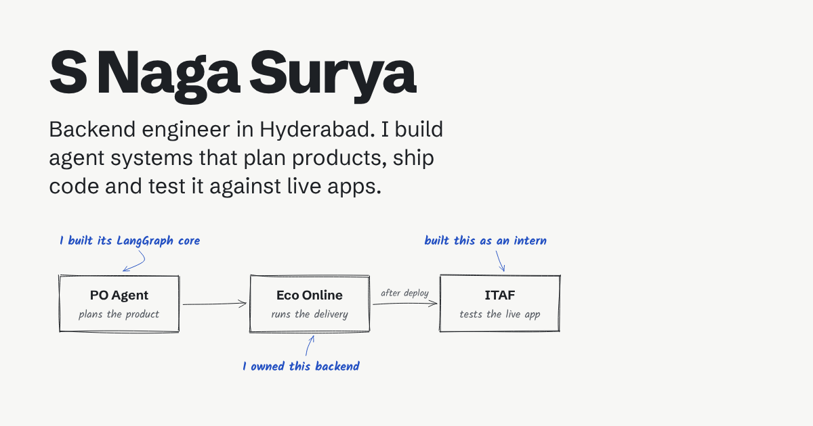

# S Naga Surya · Portfolio

Personal site of **S Naga Surya**, AI / Backend Engineer building agentic systems with LangGraph, MCP,
RAG and FastAPI. Live at **https://nagasurya.com**.



- **Hand-drawn system diagrams:** each project is explained with a whiteboard-style diagram that draws
  itself when the page opens. The drawings are generated at build time with
  [rough.js](https://roughjs.com), so the site ships no drawing code.
- **Static and fast:** built with [Astro](https://astro.build), about 1 KB of JavaScript, no UI framework.
- **Three colours, two themes:** board white, marker black and marker blue, with a graphite dark mode that
  follows the visitor's system setting and a toggle that remembers the choice.
- **Respects reduced motion:** visitors who turn off animations see the diagrams already drawn.
- **Accessible:** passes an axe-core WCAG 2.2 AA scan on every page, in both themes, on desktop and mobile.
- **Share-ready:** a preview image for every page (LinkedIn, WhatsApp, X), JSON-LD, sitemap and robots.txt.

## Run it locally

Needs Node.js 22.23.4 or newer.

```bash
npm install
npm run dev
```

Then open http://localhost:4321.

## Update your content

Everything visitors read lives in `src/data/`. You never need to touch layout code to change it.

| What                                   | Where                                                    |
| -------------------------------------- | -------------------------------------------------------- |
| Name, email, links, page title         | `src/data/site.ts`                                       |
| Intro text and the home-page diagram   | `intro` and `lifecycle` in `src/data/site.ts`            |
| Work case studies (Ideyalabs projects) | `workProjects` in `src/data/projects.ts`                 |
| Side projects (vFABit, DBeast, ...)    | `sideProjects` in `src/data/projects.ts`                 |
| vFABit case study                      | `src/data/vfabit.ts`                                     |
| Roles, education, certifications       | `src/data/experience.ts`                                 |
| Skills                                 | `src/data/skills.ts`                                     |
| Resume PDF                             | Replace `public/S-Naga-Surya-Resume.pdf` (keep the name) |

**Adding a case study:** add an object to `workProjects`. Its page at `/work/<slug>/` is created
automatically, and it appears on the home page. Then run `npm run images` to create its preview image.

**Editing a diagram:** a project's diagram is built from its `flow` steps. `title` and the short
handwritten `sub` go inside each box (keep `sub` under about 20 characters), `edges` labels the arrows
in order (`null` for none), and `notes` are the blue handwritten comments that point at a step. Flows
with more than four steps wrap onto two rows automatically, and phones get a vertical layout.

## Domain

The site is built for `https://nagasurya.com`, set in `astro.config.mjs`. Link previews, canonical URLs
and the sitemap all use it. A `SITE_URL` environment variable overrides it if you ever need to.

## Deploy

The site is hosted on **Vercel**, with the domain registered at **Hostinger**. Build settings,
caching and security headers live in `vercel.json`.

**Step-by-step guide: [docs/DEPLOYMENT.md](docs/DEPLOYMENT.md)**. It covers the first deploy, adding
`nagasurya.com`, the Hostinger DNS records, and switching to deploys from GitHub Actions so pushes to
`main` keep deploying after Vercel's GitHub connection is removed.

## Scripts

| Command           | What it does                                                      |
| ----------------- | ----------------------------------------------------------------- |
| `npm run dev`     | Local dev server with live reload                                 |
| `npm run build`   | Production build into `dist/`                                     |
| `npm run preview` | Serve the production build locally                                |
| `npm run check`   | Type-check all Astro and TypeScript files                         |
| `npm run format`  | Format everything with Prettier                                   |
| `npm run images`  | Regenerate preview images and icons (needs Playwright, see below) |

`npm run images` renders the cards in `src/pages/og/` with a headless browser. Install it once with
`npm i -D playwright && npx playwright install chromium`.

## Project structure

```text
src/
  data/        Content: site.ts, projects.ts, experience.ts, skills.ts
  components/  Page sections (Hero, WorkList, SideProjects, About, Contact) and Sketch.astro
  lib/         sketch.ts: turns a flow into hand-drawn SVG at build time
  layouts/     BaseLayout.astro: <head>, SEO tags, header and footer
  pages/       index.astro, work/[slug].astro, projects/vfabit.astro, 404.astro, robots.txt.ts,
               og/[slug].astro (preview-image cards, only built by `npm run images`)
  styles/      global.css: the three colours, type scale and diagram animation
public/        Resume PDF, icons, generated preview images
scripts/       generate-images.mjs
```

CI (`.github/workflows/ci.yml`) checks formatting, types and the build on every push and pull request.
